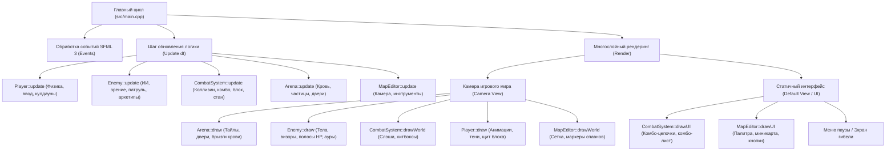

# Архитектура движка (Engine Architecture)

Документ описывает архитектурные решения, модульную структуру, главный игровой цикл и взаимодействие ключевых подсистем игры.

---

## 1. Архитектурный обзор и игровой цикл (Game Loop)

Проект построен по модульному принципу с разделением ответственности между миром, сущностями, боевой системой, вводом и рендерингом:

### 1.1. Главный цикл (Main Loop)
Игровой цикл в [src/main.cpp](file:///home/dagai/Projects/SFML_working_version/src/main.cpp) работает с ограничением кадровой частоты (144 FPS) и защитой от спирали дельты времени (`if (dt > 0.1f) dt = 0.1f;`).
Каждый кадр выполняется в три фазы:
1. **Фаза опроса событий (Event Polling)**:
   * Окно SFML 3 через `window.pollEvent()` передает события в `Player`, `CombatSystem` или `MapEditor`.
   * Обработка клавиш паузы (`Esc`), сброса (`R`), смены режима ИИ (`Tab`), хоткеев редактора (`F6`).
2. **Фаза обновления состояния (Simulation Step)**:
   * При активной паузе логика замирает.
   * При гибели персонажа включается таймер перезапуска (2 секунды либо пропуск по `Space` / `Enter`).
   * Обновление физики игрока, поведения всех врагов, проверка переходов комнат через `Arena::getOverlappingDoorTargetRoom`.
   * Фаза боя: поиск коллизий хитбоксов с хертбоксами, проверка блоков, применение урона, спавн пиксельной крови.
3. **Фаза рендеринга (Rendering)**:
   * Очистка буфера кадра.
   * Отрисовка мира в мировых координатах камеры (`window.setView(camera)`).
   * Отрисовка статического интерфейса поверх мира (`window.setView(window.getDefaultView())`).

---

## 2. Подсистемы движка

### 2.1. Подсистема окружения (`Arena`)
Класс `Arena` управляет миром:
* **Тайловая сетка**: 2D вектор `std::vector<std::vector<int>> _map`.
  * `0` — Воздух (Air).
  * `1` — Платформа / верхний слой земли (Platform, проходимый снизу-вверх при прыжках).
  * `2` — Монолитный блок / стена (Wall, абсолютно твердый AABB).
  * `3` — Настраиваемый блок двери / перехода (Door Block).
* **Система комнат**: Поддержка каталога комнат (`assets/maps/room_*.kv`).
* **Точки спавна сущностей**:
  * Спавн игрока `_spawnPosition`.
  * Список спавнов врагов `_enemySpawns` с привязкой координат и типов (`EnemySpawnConfig { position, type }`).
* **Система дверей**: Список объектов `DoorBlock { x, y, targetRoom }`. Двери размещаются **только явно** через редактор карт или KV-конфиги; никаких невидимых/дефолтных фантомных дверей нет.
* **Пиксельные брызги крови (`BloodDecals`)**: Персистентные декали на полу и стенах при добиваниях комбо.

### 2.2. Сущности (`Player` и `Enemy`)
* **`Player`**:
  * Физика: гравитация, разгон, трение, полуразмеры коллизии (`HALF_W = 14`, `HALF_H = 26`).
  * Механики мобильности: прыжок, дэш в стороны с кадром неуязвимости (i-frames), спот-додж (уклонение на месте).
  * Защита: стойка парирования (`[Q]`) и постоянный блок (`[F]` / `[E]`), поглощающий 80% урона.
* **`Enemy`**:
  * Архитектура 3 архетипов: `NORMAL` (серый), `TANK` (красный, 1.5x масштаб, тяжелая броня), `DUELIST` (фиолетовый, уклонения, блок, контратаки).
  * Система состояний ИИ: `IDLE` (патрулирование / выжидание), `ALERT` (тревога), `CHASE` (погоня с прыжками по платформам), `COMBAT` (комбо-серии).
  * Патрулирование с датчиком края платформы (не спрыгивает в пропасть при спокойном патруле).

### 2.3. Боевая подсистема (`CombatSystem`)
* Управляет буфером направленного ввода (`InputBuffer`).
* Сопоставляет последовательности ударов с деревом комбо из `combat_balance.kv`.
* Независимая анти-спам система: каждое завершенное комбо получает индивидуальный кулдаун 2.5 секунды.
* Расчет стан-локов атакующего и защищающегося (включая Whiff Stunlock и Block Stunlock).

### 2.4. Аудиосистема (`SoundManager`)
* Построена на библиотеке **miniaudio**.
* Полностью асинхронное неблокирующее воспроизведение в отдельном звуковом потоке.
* Поддержка уникальных звуков для комбинаций ударов и гибкая логика Fallback.
* Возможность горячей перезагрузки звуковых ассетов по `F5`.

