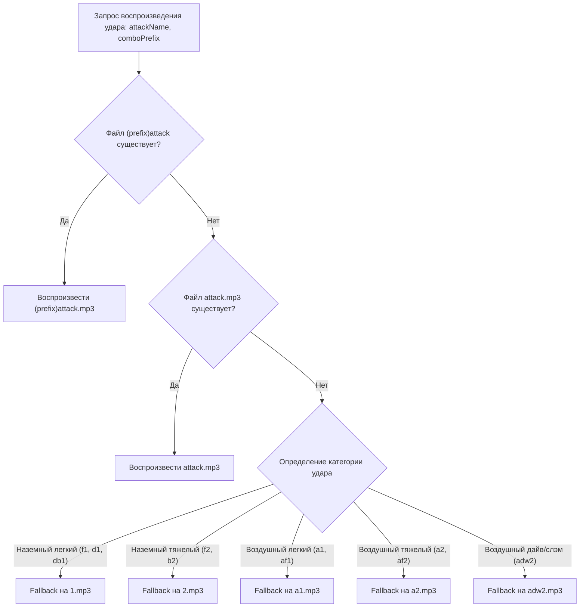

# Звуковая система (Sound System & SoundManager)

Документ описывает архитектуру аудиоподсистемы на базе **miniaudio**, правила именования звуковых файлов, систему уникальных звуков комбо-финишеров и логику Fallback.

---

## 1. Архитектура SoundManager

* **Движок воспроизведения**: Заголовочная библиотека `miniaudio.h` (C99), обеспечивающая многопоточное неблокирующее микширование звуковых потоков с нулевой задержкой.
* **Каталог звуков**: `assets/soundeff/`.
* **Поддерживаемые форматы**: `.mp3`, `.wav`, `.ogg`, `.flac`.
* **Баланс громкости**: Глобальная громкость звуков ударов и эффектов снижена в 2 раза (`masterVolume = 0.50f`), чтобы не глушить игрока при плотных комбо-сериях.

---

## 2. Соглашение об именовании файлов звуков

Звуковая система использует специальное синтаксическое соглашение для различения базовых атак и уникальных ударов внутри комбо:

### 2.1. Базовые атаки
Имя звукового файла в точности совпадает с кодовым обозначением удара:
* `1.mp3` — базовый легкий удар на земле (Neutral Light).
* `2.mp3` — базовый тяжелый удар на земле (Neutral Heavy).
* `a1.mp3` — легкий удар в воздухе (Air Light).
* `a2.mp3` — силовой толчок в воздухе (Air Heavy).
* `adw2.mp3` — пикирующий удар в землю со слэмом (Air Dive Slam).

### 2.2. Уникальные завершители комбо
Для уникальных ударов, завершающих комбо, в имени файла в круглых скобках указывается префикс предшествующей цепочки комбо:
* `(11)2.mp3` — уникальный звук завершающего апперкота в связке `1 -> 1 -> 2`.
* `(21)db1.mp3` — уникальный звук реверсивного подброса в связке `2 -> 1 -> db1`.
* `(1f2)d1.mp3` — уникальный звук диагонального лаунчера в связке `1 -> f2 -> d1`.
* `(11)b2.mp3` — уникальный звук броска за спину в связке `1 -> 1 -> b2`.

---

## 3. Логика Fallback для не указанных атак

Если для конкретного уникального удара в комбо или направленной вариации звуковой файл отсутствует, `SoundManager` автоматически подбирает наиболее подходящий базовый звук по строгим правилам:

Благодаря этой логике боевая система гарантированно озвучивает любое движение персонажей без сбоев и ошибок воспроизведения.

---

## 4. Горячая перезагрузка звуков (Hot-Reload)

При нажатии клавиши `[F5]` в редакторе карт или при обновлении файлов на диске `SoundManager` производит фоновое сканирование папки `assets/soundeff/`, выгружает устаревшие буферы и загружает новые файлы без перезапуска игры.

