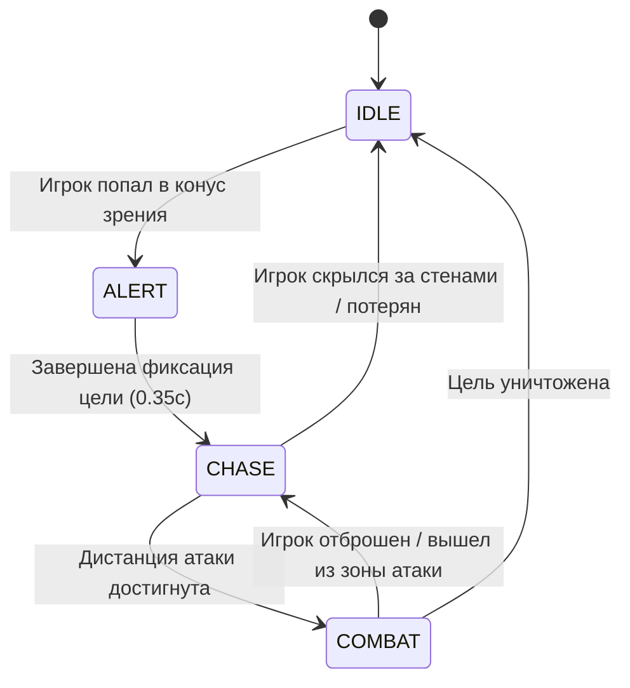

# Искусственный интеллект и архетипы врагов (Enemy AI & Boss Encounters)

Документ описывает систему конечного автомата (FSM) врагов, сенсорную систему восприятия, патрулирование, прыжки по платформам, 4 архетипа противников и механику уникального босса **БОСС 1**.

---

## 1. Сводная таблица архетипов противников

| Параметр | Обычный (`NORMAL`) | Жирный (`TANK`) | Дуэлянт (`DUELIST`) | БОСС 1 (`BOSS_1`) |
|---|---|---|---|---|
| **Цвет спрайта / корпуса** | Серый (`#969696`) | Красный (`#DC2828`) | Фиолетовый (`#AA46E6`) | Ярко-красный (`#FF1E1E`) |
| **Размер спрайта** | 1.0x (32x56 px) | 1.5x (48x84 px) | 1.0x (32x56 px) | **4x3 блока (128x96 px)** |
| **Запас здоровья (HP)** | 45 HP | 110 HP | 65 HP | **100 HP** |
| **Иммунитет к форсе** | Нет | Нет (отталкивание -50%) | Нет | **Полный иммунитет (0 форсы)** |
| **Скорость перемещения** | 225 px/s | 160 px/s | 330 px/s | 200 px/s (рывок: 500 px/s) |
| **Связывание комбо** | 1 тычок | До 2-3 ударов | До 3 ударов с отменами | **Одно комбо 2-4 удара, кулдаун 2.0с** |
| **Защитные механики** | Нет | Устойчивость к стану (Poise) | Dodge, Spot Dodge, Блок, Контратака | **Запрещены (нет блока/парирования/доджа)** |
| **Специальные атаки** | — | — | Хлыст / Притяжение цепью | **Bull Charge (таран) + Earthquake Slam** |
| **Интерфейс HP** | Над головой | Над головой | Над головой | **Центрированный Boss Bar сверху** |

---

## 2. Конечно-автоматная модель (FSM)

* **`IDLE` (Патрулирование / Ожидание)**:
  * Враг спокойно перемещается между краями платформы со сниженной скоростью.
  * Визор светится нейтральным цветом архетипа.
* **`ALERT` (Обнаружение / Тревога)**:
  * Над головой врага вспыхивает красный восклицательный знак `[!]`.
  * Враг замирает на 0.35с, поворачивается к цели и фиксирует координаты игрока.
* **`CHASE` (Погоня)**:
  * Враг на полной скорости бежит к игроку.
  * При нахождении игрока на верхних ярусах враг автоматически рассчитывает траекторию и совершает вертикальные прыжки по платформам.
* **`COMBAT` (Боевая фаза)**:
  * Враг активирует комбо-стартер или специальную атаку.

---

## 3. Патрулирование без падения с платформ (Edge Detection)

Чтобы враги не падали с обрывов на нижние ярусы во время спокойного патрулирования, внедрена система датчиков краев:
* Перед шагом вперед ИИ пускает два луча:
  1. **Горизонтальный луч**: проверяет наличие стены (`tile == 2`) перед собой.
  2. **Наклонный датчик пола**: проверяет наличие твердого блока (`tile == 1` или `tile == 2`) под следующей точкой ступни на расстоянии 16-24 px вперед.
* Если под будущей точкой шага обнаружен воздух (`tile == 0` — обрыв платформы):
  * Враг мгновенно прекращает движение вперед, обнуляет горизонтальную скорость и плавно разворачивается в противоположную сторону.
  * Во время погони (`CHASE`) датчик отключается, позволяя врагу спрыгивать вниз для преследования.

---

## 4. Разветвленные комбо-стартеры рядовых врагов

Рядовые враги используют 3 стартера комбо:
1. **`STARTER_1F2D1`**: Быстрый джеб $\rightarrow$ выпад $\rightarrow$ лаунчер.
2. **`STARTER_112`**: Серия скоростных джебов $\rightarrow$ апперкот.
3. **`STARTER_21DB1`**: Тяжелый удар $\rightarrow$ отмена в подсечку за спину $\rightarrow$ вертикальный подброс.

### Вариативность длины комбо:
* **1-ударный тычок (Poke)**: враг наносит одиночный удар и возвращается в стойку.
* **2-ударная связка (String)**: враг делает 2 удара и прерывает комбо.
* **Полная 3-ударная серия (Full Launcher)**: враг завершает связку лаунчером и прыгает следом за игроком для воздушного слэма.
* **Хит-конфирм (Hit Confirm)**: если игрок уклонился с помощью дэша (i-frames) или удар пришелся в воздух, ИИ мгновенно обрывает серию, не нанося ударов "в пустоту".

---

## 5. Уникальный энкаунтер: БОСС 1 (Boss 1)

Каждый босс в игре создается как полностью уникальный боссфайт. Первым боссом игры является **БОСС 1**:

### 5.1. Габариты и статус
* **Массивный корпус**: размер **$128 \times 96\text{ px}$ (4 блока в длину, 3 в высоту)**.
* **Цвет**: ярко-красный монолит (`sf::Color(255, 30, 30)`).
* **Здоровье**: **100 HP**. Над экраном разворачивается стильный горизонтальный Boss Health Bar с именем `БОСС 1` и текущим числовым значением здоровья.
* **Сбалансированный урон**: комбо наносят 4–8 урона, таран (Bull Charge) 10 урона, волна сотрясения 7 урона со станом 1.2с.
* **Полное покрытие хитбоксов (включая корпус и воздух до 65px над головой)**: хитбокс атаки босса рассчитывается от задней границы тела вперед (`halfW * 2.0f + forwardReach`) и на высоту $181\text{ px}$ (`halfH * 2.0f + 85.0f`), возвышаясь на **65 px выше головы босса**. Игрок не может прятаться внутри босса или безнаказанно прыгать над ним — любой прыжок над боссом сбивается мощным противовоздушным свайпом.
* **Реакция на воздушные атаки в IDLE**: если босс находится в состоянии покоя и игрок пытается атаковать его сверху в прыжке, несбиваемая стойка босса (Unflinching Poise) мгновенно запускает встречную комбо-атаку.
* **2-кадровый визуальный телеграф предупреждения**: перед каждой атакой вместо обычного замаха над головой босса появляется мигающая плашка предупреждения `[ ! ]`, а над зоной будущего удара загорается полупрозрачная красная зона поражения.
* **Физическая коллизия со стенами и блоками**: босс не ходит сквозь препятствия; горизонтальное перемещение и разбег непрерывно проверяют коллизию по 5 вертикальным точкам корпуса через `arena.isPointSolid`.
* **Гравитация и мирный покой до входа на арену**: босс подчиняется полноценной физике гравитации и устойчиво стоит на полу; пока игрок не активирует триггер боссфайта и не зайдет на арену, босс не агрится и мирно ждет героя.
* **Завершение боссфайта при гибели босса**: при падении HP босса до 0 триггер боссфайта навсегда деактивируется, динамически выставленные барьеры и блоки арены немедленно исчезают (возвращая исходный вид комнаты), камера отвязывается и возвращается на игрока (1280x720), и возобновляется обычная фоновая музыка комнаты.

### 5.2. Иммунитет к форсе и боевой кодекс
1. **Полный иммунитет к форсе (Total Force Immunity)**:
   * Любые атаки игрока, комбо-лаунчеры, броски булавы и завершители **не могут сдвинуть босса с места**.
   * Босс не получает горизонтального или вертикального импульса (`velocity.x` и `velocity.y` не изменяются от ударов игрока).
   * Босса невозможно подбросить в воздух или запустить в Wall Bounce.
2. **Отсутствие соединения комбо (No Combo Chaining)**:
   * Босс проводит строго **одну комбо-серию из 2–4 ударов**.
   * После завершения серии босс уходит на строгий фиксированный кулдаун длительностью **2.0 секунды**.
   * Босс категорически **не умеет соединять две комбо-серии подряд**, предоставляя игроку честное окно для атаки.
3. **Запрет на защитные механики**:
   * Босс не может ставить блок щитом.
   * Босс не может парировать удары игрока и применять контратаку.
   * Босс не совершает увороты (доджи).

### 5.3. Пять комбо в стиле Dark Souls
Босс обладает 5 комбо-цепочками, выполненными в тяжелом стиле Dark Souls с длинными, визуально читаемыми фазами замаха (telegraphed wind-ups):
1. **Тяжелый сокрушающий спуск**: 2 затяжных удара с колоссальным весом и широкой дугой поражения.
2. **Двойной горизонтальный размах**: 2 широких удара слева направо и справа налево.
3. **Тройной подавляющий напор**: 3 тяжелых шага вперед с чередованием вертикальных и горизонтальных ударов.
4. **Серия кругового вихря**: 3 удара вокруг себя, наказывающие игрока за попытку забежать за спину.
5. **Четырехударный молот**: длинная тяжелая связка из 4 ударов, завершающаяся мощным ударом двумя руками в пол.

### 5.4. Уникальные специальные атаки
1. **Разбег до стены (Bull Charge)**:
   * Босс принимает низкую стойку разгона, издает звуковой сигнал и на скорости $500\text{ px/s}$ таранит комнату по прямой до упора.
   * При столкновении с любой твердой стеной или блоком босс мгновенно останавливается, раздается оглушительный грохот, и босс **впадает в стан-лок на 2.8 секунды**.
   * В течение этих 2.8 секунд игрок может беспрепятственно наносить полное комбо безоружного боя или булавы.
2. **Удар по земле (Earthquake Slam)**:
   * Босс высоко поднимает руки и со всей силы бьет кулаками в землю.
   * От точки удара в обе стороны по поверхности пола разлетаются клубы пыли и бегут ударные волны.
   * Наносит **12 единиц урона** и накладывает **оглушение на 1.2 секунды** на любого персонажа, касающегося пола.
   * Игрок может полностью избежать урона и стана, вовремя совершив прыжок в воздух (`[W]` / `[Space]`).

---

## 6. Затаившийся подземный мутант (Lurker)

* **Маскировка**: затаивается под землей в монолите платформы, наружу торчат лишь колеблющиеся сенсорные усики.
* **Неуязвимость в покое**: не получает урона от обычных шагов, если игрок передвигается в кадрах неуязвимости (i-frames).
* **Окно телеграфа**: при приближении жертвы выдерживает окно предупреждения ($0.42$ с), издавая характерный скрежет, после чего извергается наружу с 3-ударной серией.
* **Наказание парированием**: успешное парирование (`[Q]`) в момент извержения вырывает мутанта из-под земли и погружает его в глубокий стан ($1.5$ с).
