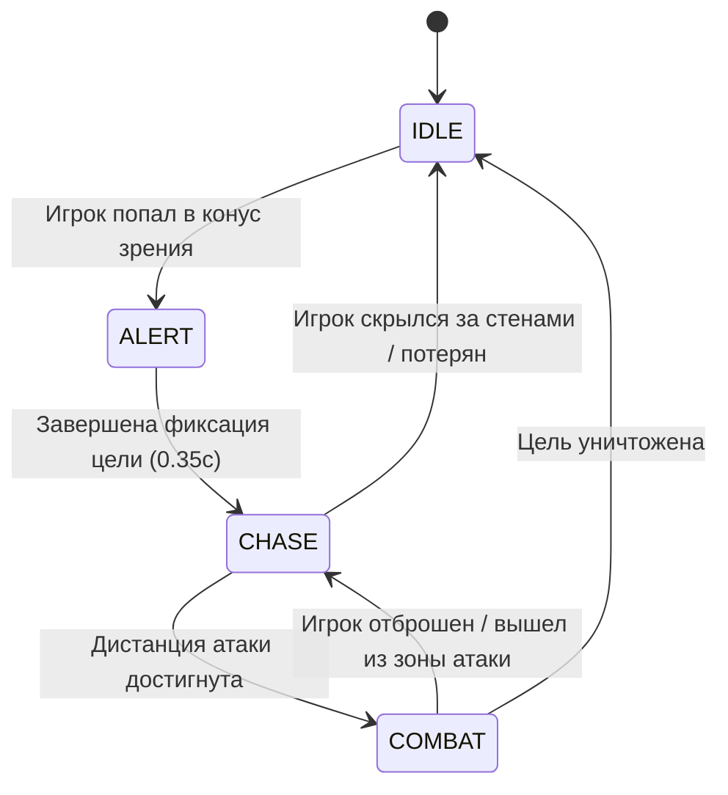

# Искусственный интеллект и архетипы врагов (Enemy AI & Archetypes)

Документ описывает систему конечного автомата (FSM) врагов, сенсорную систему восприятия, патрулирование, прыжки по платформам и три уникальных архетипа противников.

---

## 1. Три архетипа противников

В игре реализовано три уникальных архетипа врагов с визуальными, балансными и поведенческими различиями:

| Параметр | Обычный (`NORMAL`) | Жирный (`TANK`) | Дуэлянт (`DUELIST`) |
|---|---|---|---|
| **Цвет спрайта / визора** | Серый (`#969696`) | Красный (`#DC2828`) | Фиолетовый (`#AA46E6`) |
| **Размер спрайта** | Базовый $1.0\times$ (32x56) | Увеличенный $1.5\times$ (48x84) | Базовый $1.0\times$ (32x56) |
| **Запас здоровья (HP)** | 45 HP | 110 HP | 65 HP |
| **Тип брони** | Легкая | Тяжелая (снижение стана на 45%, отталкивания на 50%) | Легкая / маневренная |
| **Скорость бега** | 225 px/s (средняя) | 160 px/s (медленная) | 330 px/s (высокая) |
| **Дальность и урон атак** | Базовые | Увеличенная дистанция, повышенный урон | Быстрые серии, критические контратаки |
| **Защитные навыки** | Нет | Устойчивость к стану (Poise) | Spot Dodge, Perfect Dodge, Блок, Контратака |
| **Поведение ИИ** | 1 комбо, прямолинейный | Медленный напор, тяжелые серии | Выжидание, уклонения, адаптивные серии |
| **Специфичные статы** | — | — | `aggressiveness = 0.65`, `intelligence = 0.85` |

### 1.1. Поведение Дуэлянта (`DUELIST`)
* **Параметр Агрессивности (`aggressiveness`)**:
  * Влияет на частоту перехода в наступление против выжидания на дистанции. При низкой агрессивности дуэлянт держит дистанцию и ждет атаки игрока в защите; при высокой — активно сокращает дистанцию.
* **Параметр Интеллекта (`intelligence`)**:
  * Влияет на сложность комбо-серий и реакцию на входящие удары:
    * При атаке игрока дуэлянт способен совершить **Spot Dodge** (уклонение на месте) или **Perfect Dodge** (идеальное уклонение с мгновенным переходом в стойку парирования).
    * Умеет поднимать щит блока при приближении угрозы.

---

## 2. Конечно-автоматная модель (FSM)

* **`IDLE` (Патрулирование / Ожидание)**:
  * Враг спокойно перемещается между краями платформы со сниженной скоростью.
  * Визор светится нейтральным цветом архетипа.
* **`ALERT` (Обнаружение / Тревога)**:
  * Над головой врага вспыхивает красный восклицательный знак `[!]`.
  * Враг замирает на 0.35с, поворачивается к цели и фиксирует координаты игрока.
* **`CHASE` (Погоня)**:
  * Враг на полной скорости бежит к игроку.
  * При нахождении игрока на верхних ярусах враг автоматически рассчитывает траекторию и совершает вертикальные прыжки по платформам.
* **`COMBAT` (Боевая фаза)**:
  * Враг активирует комбо-стартер.

---

## 3. Патрулирование без падения с платформ (Edge Detection)

Чтобы враги не падали с обрывов на нижние ярусы во время спокойного патрулирования, внедрена система датчиков краев:
* Перед шагом вперед ИИ пускает два луча:
  1. **Горизонтальный луч**: проверяет наличие стены (`tile == 2`) перед собой.
  2. **Наклонный датчик пола**: проверяет наличие твердого блока (`tile == 1` или `tile == 2`) под следующей точкой ступни на расстоянии 16-24 px вперед.
* Если под будущей точкой шага обнаружен воздух (`tile == 0` — обрыв платформы):
  * Враг мгновенно прекращает движение вперед, обнуляет горизонтальную скорость и плавно разворачивается в противоположную сторону.
  * Во время погони (`CHASE`) датчик отключается, позволяя врагу спрыгивать вниз для преследования.

---

## 4. Разветвленные комбо-стартеры и вариативность длины серий

Умный ИИ использует 3 стартера комбо:
1. **`STARTER_1F2D1`**: Быстрый джеб $\rightarrow$ выпад $\rightarrow$ лаунчер.
2. **`STARTER_112`**: Серия скоростных джебов $\rightarrow$ апперкот.
3. **`STARTER_21DB1`**: Тяжелый удар $\rightarrow$ отмена в подсечку за спину $\rightarrow$ вертикальный подброс.

### Вариативность длины комбо:
Враги не всегда проводят полную 3-ударную серию:
* **1-ударный тычок (Poke)**: враг наносит одиночный удар и возвращается в стойку.
* **2-ударная связка (String)**: враг делает 2 удара и прерывает комбо.
* **Полная 3-ударная серия (Full Launcher)**: враг завершает связку лаунчером и прыгает следом за игроком для воздушного слэма.
* Вероятности зависят от интеллекта бота: обычный бот дает только 1 удар, жирный танк дает 2-3 удара, дуэлянт адаптирует связку в зависимости от дистанции и попадания.

### Хит-конфирм (Hit Confirm):
Если игрок уклонился с помощью дэша (i-frames) или удар пришелся в воздух, ИИ мгновенно обрывает серию комбо, не проводя последующие удары "в пустоту".

