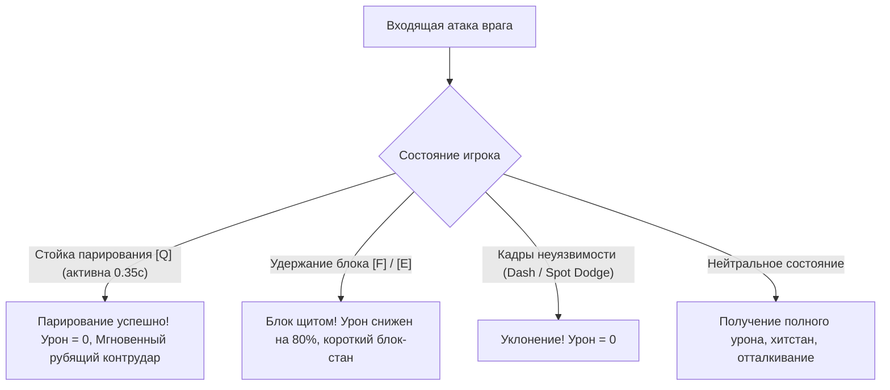

# Механики и управление игроком (Player Mechanics & Controls)

Документ описывает управление, физику движения, мобильность, защитные механики и обработку гибели главного героя.

---

## 1. Раскладка управления (Controls)

| Клавиша / Кнопка | Действие | Описание |
|---|---|---|
| `[A]` / `[D]` | Перемещение влево / вправо | Разгон и бег персонажа |
| `[W]` или `[Space]` | Прыжок | Вертикальный подскок на 135 px |
| `[S]` | Вниз | Нижняя стойка, подсечки, Air Dive Slam |
| `[Shift]` | Дэш / Рывок | Быстрый рывок с кадрами неуязвимости (i-frames) |
| `[Shift]` без нажатия клавиш движения | Spot Dodge | Уклонение на месте с кадрами неуязвимости |
| `[ЛКМ]` | Легкая атака (`1`) | Быстрые удары и стартеры комбо |
| `[ПКМ]` | Тяжелая атака (`2`) | Мощные удары и отмены комбо |
| `[Q]` | Стойка парирования | Парирование вражеской атаки с контратакой |
| `[F]` или `[E]` | Блок | Защитная стойка (поглощает 80% входящего урона) |
| `[Esc]` | Пауза | Вызов меню паузы с кнопками продолжения и выхода |
| `[R]` | Перезапуск раунда | Сброс персонажа, арены и врагов в стартовое состояние |
| `[Tab]` | Режим врагов | Переключение между режимами "Умный ИИ" и "Манекен" |
| `[Y]` | Смена архетипов | Циклическое переключение всех врагов: Normal -> Tank -> Duelist |
| `[F6]` | Редактор карт | Вход и выход из встроенного редактора карт |

---

## 2. Физика и мобильность

* **Разгон и трение**:
  * Базовая скорость бега: `300 px/s`.
  * Ускорение на земле: `1800 px/s²`.
  * Торможение при отпускании клавиш: `2400 px/s²`.
* **Гравитация и прыжок**:
  * Сила гравитации: `1400 px/s²`.
  * Начальная вертикальная скорость прыжка: `-580 px/s`.
  * Платформы (`tile == 1`) можно перепрыгивать снизу вверх (односторонняя проходимость).
* **Система уклонения (Dash & Spot Dodge)**:
  * Длительность уклонения: `0.22 секунды`.
  * Во время уклонения персонаж **полностью неуязвим к урону** (`isInvulnerable() == true`).
  * Рывок в движении перемещает персонажа со скоростью `520 px/s`.
  * Spot Dodge активируется на месте при нулевом векторе направления: персонаж остается на месте, пропуская удары сквозь себя.

---

## 3. Защитные механики: Парирование и Блок

---

## 4. Экран гибели и Permadeath Restart

* При получении фатального урона (`hp <= 0`):
  * Состояние персонажа переходит в `isDead = true`.
  * Ввод перемещения и атак полностью блокируется.
  * Экран затемняется полупрозрачным кроваво-красным оверлеем с крупной надписью **ВЫ ПОГИБЛИ**.
  * Запускается таймер обратного отсчета на **2 секунды**.
  * Игрок может мгновенно перезапуститься без ожидания, нажав `[Space]` или `[Enter]`.
  * **Полный перезапуск с начала**: игра сбрасывает мир на первую комнату (`Arena::loadRoom(1)`), персонаж возрождается на точке старта с полным здоровьем, все враги респавнятся заново.

